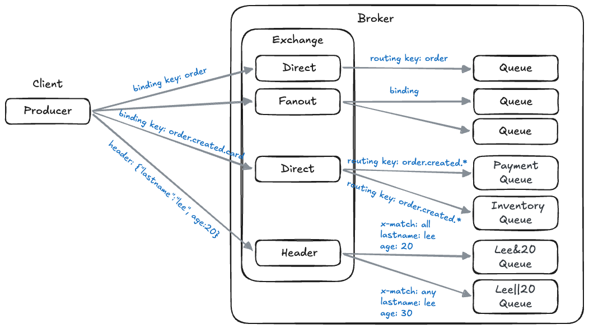
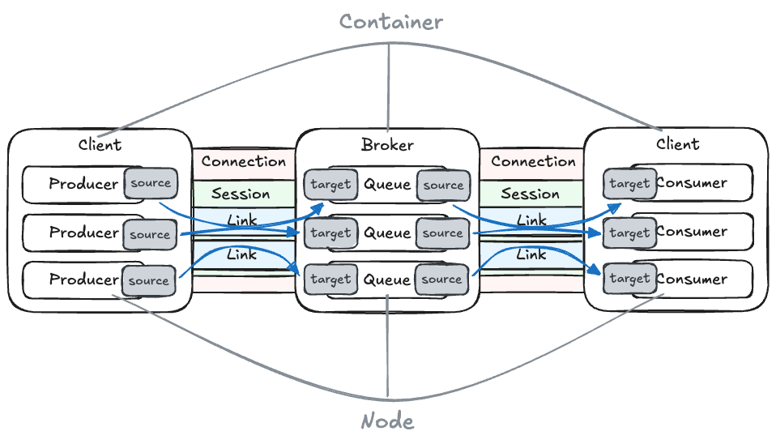
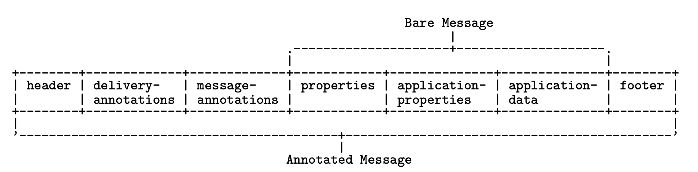

# AMQP 1.0 (Advanced Message Queuing Protocol)

## 1. 개요

### 정의

**AMQP**은 **메시지 지향 미들웨어(Message-Oriented Middleware, 이하 MOM)**&#8203;를 위한 **개방형 표준 응용 계층 프로토콜**이다.

### 배경

AMQP는 이기종 시스템 간의 원활한 메시지 전달을 위해 JPMorgan Chase의 John O'Hara에 의해 시작되었다.  
2011년 뉴욕 컨퍼런스에서 AMQP working group에 의해 발표된 AMQP 1.0은 2012년, OASIS 표준으로 승인되었으며, 2014년 ISO 및 IEC 국제 표준으로 승인되었다.

### JMS와 차이

메시징 시스템이 제공해야 하는 API 수준과 동작 집합을 정의하는 JMS와 달리, AMQP는 네트워크상에서 전달되는 데이터 형식을 바이트 스트림 형태의 와이어 레벨(Wire-level)로 정의한다. 이를 통해 서로 다른 AMQP 구현체(벤더) 간의 완벽한 상호 운용성을 높이기 위한 표준을 제공하여 특정 프로그래밍 언어나 플랫폼으로부터의 독립성을 보장한다.

## 2. 핵심 특징

### 메시지 지향 (message-oriented)

---

AMQP는 메시지 구조(Message Format)와 인코딩 방식을 표준화하여 생산자(Producer)가 만든 메시지를 일관된 형식으로 전달한다.

또한 생산자와 소비자(Consumer) 간 메시지 처리 결과(Disposition Performatives)를 주고 받음으로써 메시지 전달 상태(Delivery State)의 전이 과정을 관리한다.

표준화된 메시지 구조와 전이 상태 관리를 통해 서로 다른 메시징 시스템 간 일관된 메시지 교환이 가능하게 한다.

### 큐잉 (queuing)

---

#### 분배 노드 (Distribution Node)

**분배 노드**는 메시지를 보관하고 분배하는 노드로, 브로커(Broker)의 큐(Queue)가 대표적인 예이다,

AMQP 1.0은 분배 노드에 저장된 메시지의 상태를 **AVAILABLE**, **ACQUIRED**, **ARCHIVED**로 정의한다.

- **AVAIABLE**: 메시지가 분배가능한 상태
- **ACQUIRED**: 특정 링크가 메시지를 획득하여, 다른 링크가 메시지를 획득할 수 없는 상태
- **ARCHIVED**: 메시지가 더이상 분배될 수 없는 상태

#### 분배 모드(Distribution Mode)

분배 노드의 소스(Source)는 **분배 모드**를 설정하여 메시지를 **move** 또는 **copy** 방식으로 소비자에게 분배한다.

- **move:** 특정 링크가 메시지를 획득하면 메시지가 **ACQURIED** 상태로 전이되고, 계속하여 성공적인 전달 결과를 받는 경우 **ARCHIVED**로 상태 변경하여 해당 메시지를 분배 대상에서 제외
- **copy:** 메시지를 전달한 후에도 원본을 분배 노드에 **AVAIABLE** 상태로 보관하여 분배가능한 상태로 유지

### 라우팅 (routing)

---

#### AMQP 1.0

**주소(Address)**&#8203;는 메시지가 보내지거나 소비되는 노드를 결정한다.  
그러나 AMQP 1.0 버전에서는 주소가 어떤 내부 객체를 참조하는지, 그리고 어떻게 해석되는지 표준화하지 않는다.  
따라서 라우팅 구현을 알고 싶다면 사용하고자 하는 각각의 AMQP 1.0 구현체의 공식 문서를 확인해야 한다.

#### AMQP 0-9-1

**익스체인지(exchange)**&#8203;는 생산자로부터 메시지를 수신하고 바인딩(Binding)과 라우팅 키(Routing key)를 기준으로 메시지를 특정 큐로 라우팅한다.

익스체인지는 다음 주요 네 가지 유형을 지원한다.

- **Direct:** 라우팅 키와 바인딩 키(Binding key)가 일치하는 큐로 메시지를 라우팅
- **Fanout:** 자신에게 연결된 모든 큐에 메시지를 라우팅
- **Topic:** 라우팅 키와 바인딩 키의 패턴을 비교하여 매칭되는 큐로 라우팅
- **Headers:** 메시지 헤더 속성의 key-value를 바인딩 조건과 비교하여 매칭되는 큐로 라우팅한다. 바인딩 시 모든 key-value를 매칭할지(all), 어느 하나라도 매칭할지(any) 설정할 수 있다.

### 신뢰성 (reliability)

---

- **메시지 전달 보장**
  - **AMQP 1.0**
    송신자(Sender) 또는 수신자(Receiver)는 처리 결과(Disposition Performatives)를 통해 송/수신된 메시지의 최종 처리 상태에 합의하여 고유한 메시지 전달을 보장한다.

    메시지 전달 보장 방식에는 세 가지 유형이 있다.
    - **최대 한 번(At-Most-Once)**  
      송신자가 메시지를 보내자마자 즉시 확정(Settled)한다. 수신자는 받은 메시지의 상태 전이 변경에 대한 응답할 의무가 없으므로 메시지 소실 가능성이 존재한다.
    - **정확히 한 번(Exactly-Once)**
      송신자가 보낸 메시지를 수신자가 처리한 후 처리 결과를 보내면 송신자가 확정한 후 확정 결과를 수신자에게 보내면 수신자도 확정한다.  
      단, 비즈니스 처리까지 포함한 Exactly-once를 AMQP가 보장하는 것은 아니다.
    - **적어도 한 번(At-Least-Once)**
      송신자가 메시지를 미확정(Unsettled) 상태로 보내고, 수신자가 메시지를 처리한 뒤 확정한 후 처리 결과를 보내면 응답받은 송신자가 확정한다.  
       단, 송신자가 수신자의 처리 결과 메시지를 받지 못한 경우 중복 처리될 수 있다.

  - **AMQP 0-9-1**
    - **생산자 확인 (Publisher Confirms)**  
       생산자가 메시지를 브로커(Exchange)에 전송하면, 브로커가 안전하게 수신했음을 확인한다.
    - **소비자 승인 (Consumer Acknowledgements / ACK)**  
       소비자는 메시지를 처리한 후 브로커에게 ACK를 보낸다. ACK를 보내기 전에 연결 종료 등의 사유로 컨슈머가 죽으면 브로커는 다른 소비자가 처리할 수 있도록 다시 메시지를 큐에 넣는다.

- **데이터 지속성 (Durability & Persistence)**  
  메시지의 지속성과 터미너스(Terminus)의 지속성을 구분하여 관리한다.
  - 메시지 지속성(Durable Messages): 브로커가 수락한 이후 장애가 발생해도 메시지를 보존해야 된다.
  - 터미너스 지속성(Durable Terminus): 소스와 타겟을 일컫는 터미너스의 **존재 여부**, **설정값**, **영속성 메시지의 상태**의 보존 여부를 다음의 기준에 따라 설정한다.

    | 값  | 이름            | 보존되는 상태                                                                                                                                         |
    | --- | --------------- | ----------------------------------------------------------------------------------------------------------------------------------------------------- |
    | 0   | none            | 아무 상태도 보존하지 않음. 엔드포인트가 종료되거나 연결이 끊기면 모든 정보가 사라집니다.                                                              |
    | 1   | configuration   | 존재 여부와 설정만 보존. 터미너스 자체(주소, 기본 설정 등)는 유지되지만, 처리 중이던 메시지 상태는 유실됩니다.                                        |
    | 2   | unsettled-state | 설정과 영속성(durable) 메시지의 상태 모두 보존. 터미너스 설정뿐만 아니라 아직 전송이 완료(settled)되지 않은 영속성 메시지의 상태까지 모두 유지됩니다. |

  이를 통해 메시지를 디스크에 저장하여 서버가 재시작된 후에도 메시지를 보존할 수 있다.  
  다만 실제 디스크 기록 및 복구 방식은 메시징 브로커의 구현과 설정에 따라 달라진다.

- **연결 안정성 (Connections & Heartbeats)**  
  AMQP 1.0은 Open Performatives의 idle-time-out 필드를 통해 연결(Connection) 유휴 시간을 제한할 수 있다.  
  메시지를 보내지 않아도 연결을 계속 유지해야되는 경우, 빈 프레임(emtpy frame)을 주기적으로 전송하여 연결을 유지한다.
- **에러 핸들링(Error Handling)**  
  AMQP 1.0은 메시지 전달 결과 중 Rejected를 통해 유효하지 않거나 처리할 수 없는 메시지에 대해 에러 내용을 포함하여 전달 상태를 표현할 수 있다.  
  또한 연결, 세션, 링크 수준에서 발생하는 오류를 Error Condition으로 전달하여 프로토콜 통신 과정 중의 오류를 식별할 수 있다.

### 보안 (security)

SASL을 통해 MOM과 클라이언트 간 인증 메커니즘을 제공하며, 외부 TLS를 지원하여 암호화된 데이터를 안전하게 송수신할 수 있다.

## 3. AMQP 1.0 아키텍처

AMQP 1.0의 아키첵처는 다음과 같다.

각 구성요소에 대한 설명은 다음과 같다.
|구성 요소| 역할| 예시|
|---|---|---|
|Container| AMQP Endpoint를 포함하는 실행 환경 |Client/Broker Application|
|Node| 메시지를 송수신하거나 저장하는 논리적 개체|Producer, Consumer, Queue|
|Connection| Container 간 Frame 전송|-|
|Session| 하나의 Connection 내에서 관련된 여러 Link를 그룹화하고, 양방향 순차 통신을 제공하는 논리적인 통신 컨텍스트 |-|
|Link| Node 간 메시지를 전달하는 통신 경로|-|
|Source| 메시지를 가져오는 출발지(Link의 Endpoint)|-|
|Target| 메시지를 전달하는 목적지(Link의 Endpoint)|-|

## 4. AMQP 1.0 스펙

AMQP 스펙은 (i) 타입 시스템(type system), (ii) 균형적이고 비동기적인 메시지 전송 프로토콜, (iii) 표준적이고 확정 가능한 메시지 포맷, (iv) 표준화되었지만 확장 가능한 '메시징 기능' 집합으로 정의된다.

### (i) 타입 시스템

타입 시스템은 **Primitive Types**과 **Described Types**으로 구분된다.

- **Primitive Types:**
  - 타 언어에서 제공하는 기본 타입과 비슷하게 `int`, `long`, `float`, `double`, `string`, `symbol`, `list`, `map`, `array` 등의 타입을 제공한다.
- **Described Types:**
  Described Types는 기존 AMQP 타입에 descriptor를 부여하여 고객정보와 같은 Custom Type을 표현하기 위해 사용된다.
  Descriptor는 symbolic과 unsigned long 타입으로 표현할 수 있으며, Symbolic Descriptor와 Numeric Descriptor 두 가지 형식으로 표현할 수 있다.
  - Symbolic Descriptor: <domain>:<name> 형식으로 도메인과 이름을 조합
  - Numeric Descriptor: (domain-id << 32) | descriptor-id 형식으로 도메인 ID와 도메인 내 디스크립터 ID를 조합

### (ii) 메시지 전송 프로토콜

#### 프로토콜 계층 구조

AMQP의 메시지 전송 프로토콜은 `Connection → Session → Link` 순서의 계층 구조로 이루어진다.

- **Connection**
  - 두 컨테이너(Container) 간 설립된 TCP 커넥션 위에서 연결이 맺어지며, 프레임을 전송한다.
  - 하나의 연결은 여러 세션을 수용할 수 있다.
  - `open`, `close` Performatives를 통해 연결을 맺거나 끊을 수 있다.
- **Session**
  - Connections 위에서 Link를 통한 메시지 전송을 위한 컨텍스트를 제공한다.
  - Sessions은 여러 Links를 생성할 수 있다.
  - Link로 전달된 메시지는 세션 범위에서 전달 순번을 공유하여 여러 순번을 묶어서 한번에 응답을 보낼 수 있다.
  - `begin`, `end` Performatives를 통해 세션을 시작하거나 종료할 수 있다.
- **Link**
  - Session 위에서 소스와 타겟 간 단방향 메시지 전송을 담당한다.
  - 송신자는 각 Delivery에 Link 범위에서 고유한 `delivery-tag`를 부여하여 전달을 식별한다.
  - Link Endpoint는 메시지에 Session 범위로 고유한 순번인 `delivery-id`를 부여하여 여러 메시지 전달을 효율적으로 관리한다.
  - `attach`, `detach` Performatives를 통해 링크를 연결하거나 해제할 수 있다.

#### Performatives

AMQP는 프레임에 포함된 Performative를 통해 Connection, Session, Link의 생성 및 종료, 메시지 전송, 전달 상태 관리와 흐름 제어를 수행한다.

Performative는 다음의 9가지 유형으로 구분된다.

| 구분 | Performative | 설명                  |
| ---- | ------------ | --------------------- |
| 시작 | Open         | Connection 시작       |
| 시작 | Begin        | Session 시작          |
| 시작 | Attach       | Link 연결             |
| 전송 | Transfer     | 메시지 전송           |
| 제어 | Flow         | 흐름 제어             |
| 제어 | Disposition  | 메시지 전달 상태 제어 |
| 종료 | Detach       | Link 해제             |
| 종료 | End          | Session 종료          |
| 종료 | Close        | Connection 종료       |

#### 흐름 통제

AMQP는 흐름 통제(Flow Control)을 통해 메시지 전송을 제어할 수 있다.  
**link-credit**, **delivery-count**, **available**, **drain** 속성 값을 기반으로 하나의 Link를 통해 수신자가 허용하는 메시지 전송량과 송신자의 전송 상태를 관리한다.

- **link-credit:** 수신자가 허용한 메시지 전송 수
- **delivery-count:** Link에서 송신자가 시작한 Delivery의 순번을 나타내는 값
- **available:** 송신자가 전송할 수 있다고 알리는 메시지 수
- **drain:** 남은 메시지를 전송한 뒤 사용하지 않은 Link Credit까지 소진하도록 요청하는 모드

이를 통해 Link 내 허용되는 메시지 한도를 관리하여 메시지 전송 흐름을 제어한다.

### (iii) 메시지 포맷

생산자 애플리케이션에서 만들어진 불변(immutable)의 메시지를 **bare message**라고 하며, 전송 과정 중 bare message의 헤더(header)와 푸터(footer)에 annotation이 추가된 메시지를 **annotated message**라고 한다.

메시지는 다음과 같이 구성된다.

|Section|설명|용도|
|---|---|---|
|header|메시지 전송 관련 표준 세부사항|메시지의 영속성 여부(durable) 설정 및 흐름 제어(TTL, priority) 등|
|delivery-annotations|특정 전송 구간에서 사용되는 비표준 세부사항|브로커별 라우팅 힌트, 파티션 오프셋, 전송 제어 등|
|message-annotations|인프라 전반에서 모든 전송 구간에서 전파되는 메시지 메타데이터 |인프라 라우팅 및 스케줄링 설정 등|
|properties|메시지 표준 특성|메시지 ID, 상관관계 ID, 만료 시간 등|
|application-properties|애플리케이션에서 사용되는 사용자 정의 속성|필터링 또는 라우팅 용도의 속성값|
|application-data|실제 애플리케이션 데이터|-|
|footer|메시지 또는 전달에 관련된 세부사항|메시지 해시값, 서명, 암호화 세부사항 등|

- Bare Message는 AMQP 네트워크 내에서 불변성을 유지한다.  
  AMQP 중개자는 Bare Message에 포함된 Section의 내용을 임의로 수정하거나 원본에 존재하지 않는 Sections을 추가할 수 없다.
  이를 통해 송신자가 생성한 메시지의 바이너리 인코딩을 기반으로 Hash, HMAC, Digital Signature 등의 무결성 검증이 가능하다.
- properties와 annotations은 모두 AMQP 타입 시스템을 사용해 엄격하게 작성되어야 한다.
- application data는 형식과 인코딩을 자유롭게 설정할 수 있으며, 다만 AMQP 타입 시스템을 사용하여 구조적이고, 그 자체로 의미를 나타낼 수 있는 데이터로 표현할 수 있다.

### (iv) 메시징 기능

AMQP는 단순한 통신 프로토콜이 아닌 MOM을 위한 프로토콜이다. 따라서 거대한 메시징 네트워크 상에서 브로커, 브릿지 등과 같은 메시징 중개자와 애플리케이션과 같은 시스템이 완벽하게 상호 작용하기 위한 기능을 제공한다.

AMQP는 큐나 토픽과 같은 메시지 집합 장소인 분배 노드에 대한 공통적인 동작 지침을 표준화하였다.

공통적인 동작 지침은 다음과 같다.

- **처리 결과 표준화(Standard Outcomes)**  
   소비자가 메시지를 성공적으로 처리했는지(accept) 혹은 문제가 발생하여 실패했는지(reject) 등의 처리 결과를 규격화된 상태 신호로 주고 받을 수 있어야 한다.  
   표준 처리 결과는 다음의 유형이 존재한다.
  |Outcome| 의미|예시|
  |---|---|
  |Accepted| 메시지를 정상적으로 수락|-|
  |Rejected| 메시지를 거부|메시지 형식 불일치, JSON 파싱 에러, 필수값 누락 등 영구적인 오류 발생 |
  |Released| 메시지를 처리하지 않고 그대로 반환|수신자 애플리케이션 종료 등으로 인한 메시지 처리 불가|
  |Modified| 수신자가 더이상 점유하지 않고 동일 또는 다른 수신자에게 재전달 가능한 상태 |메시지 처리 중 오류 발생, DB 락 등 일시적 오류 발생|
- **두 가지 메시지 분배 패턴 지원**  
  소비자들이 메시지를 어떻게 나누어 가질 것인지 요청하거나 표시할 수 있다.
  - **move(경쟁 모드, Competing):** 한 소비자가 메시지를 가져가면 다른 소비자는 해당 메시지를 수신할 수 없도록 메시지를 큐에서 지운다.
  - **copy(비경쟁 모드, Non-competing):** 여러 소비자가 동일한 메시지를 복사하여 나누어 갖는 방식으로 broadcast, pub/sub에서 주로 사용된다.
- **동적 노드 생성(On-demand node creation)**  
  메시지 송수신 중 필요하다면 임시로 응답받을 수 있는 큐(Temporary response queue)를 생성하여 별도의 채널로 메시지를 받고 싶을 때 동적으로 노드를 생성할 수 있어야한다.
- **메시지 필터링 (Filters)**  
  소비자가 특정 조건을 만족하는 메시지만 받고자 할 때, 관심 있는 메시지만 받을 수 있는 필터링 기능을 제공해야 한다.

## 5. AMQP 1.0 준수 구현체

- Apache Qpid
- Apache ActiveMQ
- Azure Service Bus
- IBM MQ
- RabbitMQ (4.X)

# 6. AMQP 기반 메시징 시스템 도입 시 고려사항

## 1) 메시지 처리 보장

AMQP 1.0은 메시지 전달 상태와 확정(Settlement)을 관리하기 위한 메커니즘을 제공한다. 하지만 실제 메시지 전달 보장 수준은 Settlement Mode, 메시지 및 Broker의 내구성 설정 등에 따라 달라진다. 또한 메시지 전달이 성공하더라도 애플리케이션의 비즈니스 로직 처리 순서와 중복 실행까지 보장하지는 않는다.

### 메시지 처리 순서

여러 소비자가 병렬로 메시지를 처리하거나 실패한 메시지가 재전달되면 순차적인 메시지 처리를 보장할 수 없다.

주문 완료 → 결제 → 취소와 같이 순차적인 처리를 보장해야되는 상황에서 주문 완료하기 전에 결제를 진행하는 문제가 발생할 수 있다.

따라서 순서가 중요한 메시지는 순차적으로 처리하거나 순차 처리 단위를 묶어 단위별로 병렬 처리하도록 설계해야한다.

### 메시지 중복 전달

장애 발생 시 메시지가 중복 전달될 수 있는 케이스틑 다음과 같다.
|발생 지점| 원인|
|---|---|
|Consumer → Broker| 처리 완료 후 처리 결과가 포함된 응답 유실|
|Consumer| 내부 비즈니스 처리 완료 후 처리 결과 응답 전 프로세스 종료|
|Producer → Broker| Broker가 메시지 수신 후 확인 응답 유실로 인한 Producer의 메시지 재전송|

이러한 케이스에서 메시지가 여러 번 전달되어 동일한 비즈니스 로직이 중복 실행될 수 있다.

따라서 메시지 전달과 비즈니스 처리는 원자적으로 처리할 수 없으므로 동일한 메시지 처리에 대한 **멱등성**을 고려해야한다.

### 메시지 내구성과 전달 보장

메시지의 내구성 설정, Broker의 저장 정책, 송신자와 수신자의 Settlement 시점 등에 따라 메시지 보장 수준이 달라진다.

- 메시지 내구성  
  메시지의 헤더 속성인 durable 값 설정에 따라 메시지 유실 가능성이 발생한다.
- Broker의 저장 정책  
  Terminus(Source & Target)의 durable 속성값에 따라 브로커 장애 시 메시지를 포함한 데이터 생존 여부가 결정된다.
  - durable = 0 : 어떠한 값도 저장하지 않음
  - durable = 1 : Terminus의 존재 여부, 환경 설정 값만 저장
  - durable = 2 : Terminus의 존재 여부, 환경 설정 값 이외에 durable message의 unsettled 상태도 저장
- Settlement 시점
  송신자와 수신자의 Settltment 시점에 따라 메시지 전달 보장 수준이 달라지며, 메시지 유실 및 중복 전달 가능성이 발생한다.

메시지 내구성 미설정 등으로 인해 브로커 장애 시 메시지 유실 및 중복 전달이 발생한다.

- 메시지 유실
  메시지의 durable 값을 false 설정 시 브로커 장애로 인한 종료 후 재시작 시 메시지 보존이 보장되지 않는다.  
  Terminus의 durable 값을 0 또는 1로 설정하는 경우 미확정 전달 상태의 메시지 복구가 보장되지 않기 때문에 메시지 자체의 내구성은 메시지의 내구성과 Terminus 내구성을 동시에 고려해야한다.  
  또한 At-most-once 전달 보장 수준에서 생산자는 메시지를 한 번만 전송하고 Broker의 응답을 기다리지 않으므로 네트워크 장애 시 메시지 유실 가능성이 존재한다.
- 중복 전달
  At-least-once 전달 보장 수준에서 소비자가 비즈니스 처리 완료 후 Settlement할 때 장애로 인해 Broker가 처리 결과를 받지 못하는 경우 Broker가 동일한 메시지를 재전달하여 메시지 중복 전달 가능성이 존재한다.

따라서 메시지 내구성 설정과 전달 결과 확인 시점을 고려하여 메시지 유실을 방지하고, 멱등성을 함께 고려하여 메시지 중복 전달을 방지해야한다.

## 2) 분산 트랜잭션과 정합성

메시지 브로커의 트랜잭션과 데이터베이스 트랜잭션은 별개이므로 원자성이 보장되지 않는다.  
따라서 다음과 같은 이중 쓰기(Dual-write) 문제가 발생할 수 있다.

- 생산자가 DB 트랜잭션을 통해 주문 완료 후 Broker로 메시지를 전송하는 과정에서 장애가 발생하여 메시지가 유실되었다. 따라서 결제 시스템에서 주문이 처리됐다는 메시지를 받지 못해 결제되지 않는 문제가 발생한다.
- 소비자가 주문 완료 메시지를 전달받아 결제 완료 처리를 하고 Broker로 처리 결과를 보내는 중 장애가 발생하여 Broker가 결제 완료 사실을 알지 못한다. 따라서 Broker가 동일한 메시지를 재전달하여 중복 결제되는 문제가 발생한다.

Transactional Outbox 패턴, inbox 패턴, 멱등성 등을 고려하여 메시지 전달과 비즈니스 데이터 간 정합성을 확보해야된다.

### 브로커별 기능과 설정 차이로 인한 운영 종속성

| 비교 항목          | RabbitMQ                          | Azure Service Bus            | ActiveMQ Artemis                         |
| ------------------ | --------------------------------- | ---------------------------- | ---------------------------------------- |
| 메시지 라우팅 모델 | Exchange / Binding / Queue        | Queue / Topic / Subscription | Address / Queue                          |
| 메시지 재전달      | Requeue 및 DLX                    | MaxDeliveryCount 및 DLQ      | Redelivery Policy 및 Dead Letter Address |
| 중복 메시지 처리   | 애플리케이션 수준의 멱등성 설계   | Duplicate Detection 지원     | 애플리케이션 수준의 멱등성 설계          |
| 트랜잭션           | AMQP 1.0 Transactions 미지원      | 지원                         | 지원                                     |
| 다중 프로토콜      | AMQP 1.0, AMQP 0-9-1, MQTT, STOMP | AMQP 1.0 중심                | AMQP 1.0, Core, OpenWire, MQTT, STOMP    |

AMQP는 메시지 교환을 윈한 표준 프로토콜이지만 메시지 라우팅 및 재전달 정책, 중복 메시지 처리와 트랜잭션 등의 세부 기능은 브로커 구현체에 따라 차이가 존재한다.  
따라서 동일한 AMQP 프로토콜을 사용하더라도 브로커별 기능과 설정 방식에 따라 애플리케이션 구현 및 운영 방식이 달라질 수 있다. 특정 브로커의 고유 기능에 대한 의존성을 줄이고, 브로커 교체 가능성을 고려한 설게가 필요하다.
